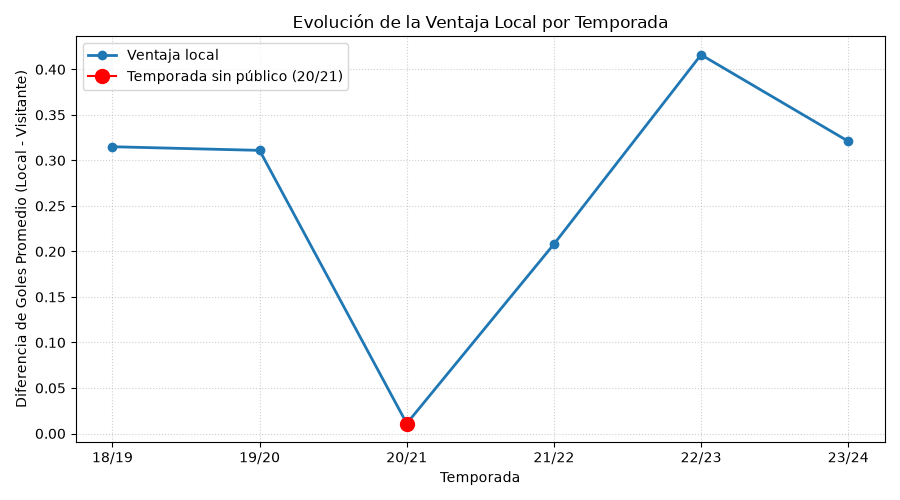
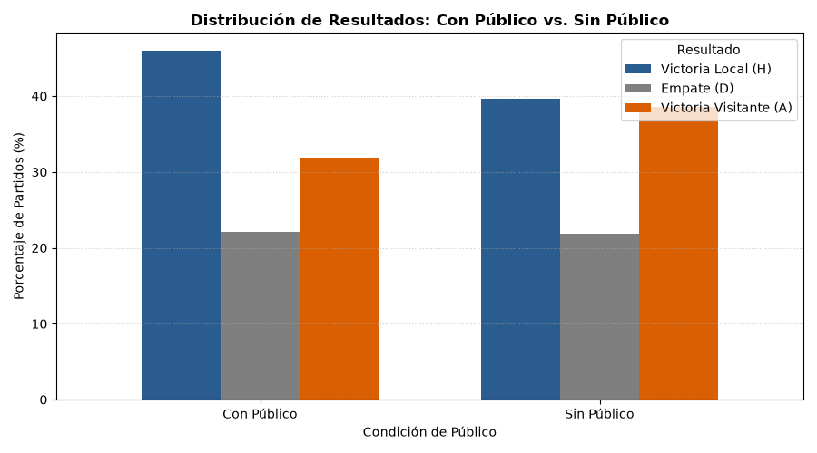
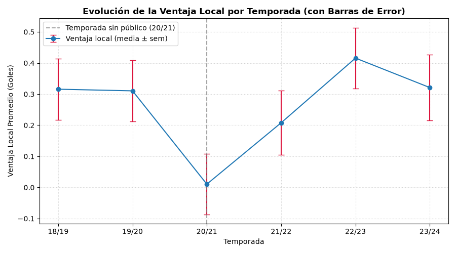
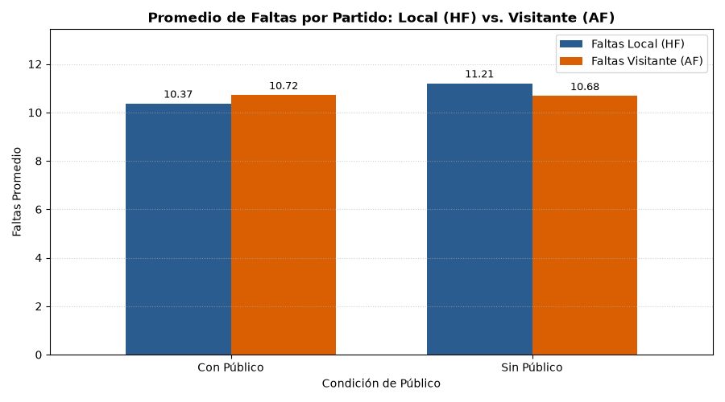
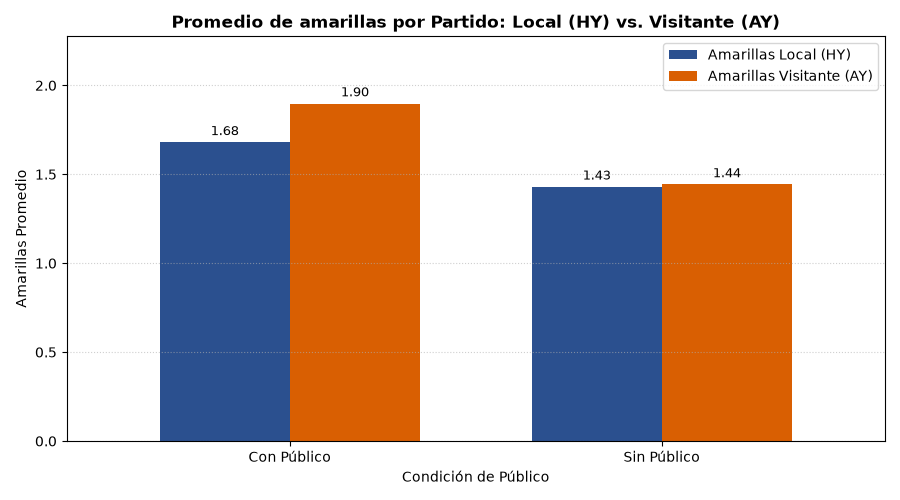
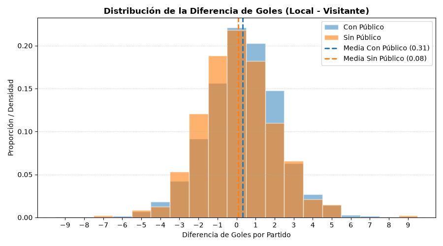

# Análisis de la Premier League: ¿cuánto vale jugar en casa?

## Qué hay aquí
Este proyecto analiza el impacto real del público en la ventaja de jugar como local en la Premier League utilizando datos de 6 temporadas. La conclusión central es que sin espectadores en las gradas, la ventaja local prácticamente desaparece; el patrón de faltas y tarjetas apunta al comportamiento arbitral como mecanismo, aunque el diseño no permite descartar otras causas.

## Datos
El conjunto de datos comprende 6 temporadas (desde la 18/19 hasta la 23/24), abarcando un total de 2.280 partidos extraídos de football-data.co.uk.

Las principales columnas utilizadas y sus significados son:
* **Date**: Fecha del partido (formato DD/MM/AAAA).
* **HomeTeam / AwayTeam**: Equipo local y equipo visitante.
* **FTHG / FTAG**: Goles marcados a tiempo completo por el equipo local y visitante.
* **FTR**: Resultado a tiempo completo (H = Victoria local, D = Empate, A = Victoria visitante).
* **HF / AF**: Faltas cometidas por el equipo local y visitante.
* **HY / AY**: Tarjetas amarillas mostradas al equipo local y visitante.
* **HR / AR**: Tarjetas rojas mostradas al equipo local y visitante.
* **Referee**: Árbitro principal del encuentro.
* **B365H / B365D / B365A**: Cuotas de apuestas de Bet365 para Local, Empate y Visitante.

## Resultados
1. La ventaja local en goles por partido cayó de +0.31 a +0.08 goles durante los partidos sin público (diferencia de 0.23 goles, IC 95%: [0.03, 0.43]). 

2. El porcentaje de victorias del equipo local se redujo del 46.0% al 39.6% (diferencia de -6.4%, IC 95%: [-11.6, -1.2]), mientras que las victorias visitantes aumentaron del 31.9% al 38.6%. 

3. La estabilidad de la caída en la ventaja local se confirma al analizar las desviaciones y el error estándar por temporada, registrando su único valor cercano a cero (+0.01 goles) en la temporada atípica 20/21. 

4. El comportamiento arbitral en cuanto a faltas se desequilibró: con público, el local cometía un promedio de 10.37 faltas frente a 10.72 del visitante; sin público, el local pasó a cometer 11.21 faltas frente a 10.68 del visitante. 

5. Las tarjetas amarillas muestran un descenso generalizado sin público, pero la brecha se cierra porque el visitante deja de recibir el exceso: el local pasó de 1.68 a 1.43 amarillas por partido, mientras que el visitante bajó de 1.90 a 1.44. 

6. El impacto del público se concentra en los partidos cerrados: las victorias locales ajustadas (1-2 goles) cayeron del 35.0% al 29.2% (IC 95%: [1.1, 10.4], significativo), mientras que las goleadas locales (≥3 goles) pasaron del 11.0% al 10.4% (no concluyente). 


## Metodología y decisiones
* **Definición de "sin público":** Se delimitaron los encuentros oficiales a puerta cerrada desde el parón por la pandemia el 13 de marzo de 2020 hasta el 31 de mayo de 2021, abarcando 472 partidos frente a 1.808 partidos con público.
* **Zona gris:** Se contabilizaron de manera estricta las fechas oficiales de restricciones sanitarias gubernamentales en el Reino Unido, reconociendo que hubo jornadas transitorias con aforos muy reducidos a finales de 2020.
* **Cálculo del margen:** Se emplearon medias, desviaciones estándar muestrales y el error estándar (SE = sigma / sqrt(n)), calculando intervalos de confianza al 95% (+- 2 SE) para validar que las diferencias observadas no son producto del azar.

## Limitaciones
La correlación no implica necesariamente causalidad absoluta. Entre las explicaciones alternativas a considerar se encuentran:
* Cambios en la condición física de los futbolistas tras el confinamiento y variaciones derivadas de un calendario fuertemente comprimido.
* La introducción de la regla de 5 sustituciones en lugar de 3 a partir de 2020.
* El matiz clave de que estas explicaciones estructurales encajan principalmente sobre los 92 partidos disputados durante el verano de 2020, y no de forma uniforme sobre toda la temporada 20/21 completa. Se descartan hipótesis especulativas sin respaldo empírico relacionadas con variaciones en el cansancio por viajes a estadios vacíos.

## Contenido del repositorio
* `tabla.py`: Script básico en Python para la lectura de CSV y generación de tablas de clasificación y validación de partidos.
* `tabla_desde_cero.py`: Script alternativo para construir la estructura de tablas y métricas sin depender de librerías externas complejas.
* `matriz_goles.py`: Análisis matricial avanzado utilizando NumPy para procesar goles, conteo de marcadores exactos y estadísticas por equipo.
* `algebra_numpy.py`: Script complementario para cálculos matriciales y transformaciones lineales de rendimiento deportivo.
* `graficas_ventaja.py`: Script encargado de procesar el histórico de las 6 temporadas y generar todas las visualizaciones gráficas guardadas en la carpeta `figuras/`.
* `ventaja_local.ipynb`: Notebook interactivo de análisis exploratorio para el cálculo de probabilidades, distribuciones de resultados y pruebas estadísticas.
* `algebra_numpy.ipynb`: Notebook interactivo enfocado en la validación matricial y demostraciones algebraicas del modelo de rendimiento.

## Cómo ejecutarlo
1. Clona este repositorio y asegúrate de tener instalado Python 3.12 o superior.
2. Crea un entorno virtual e instálalo:
   ```bash
   python -m venv .venv
   source .venv/bin/activate  # En Windows: .venv\Scripts\activate
   ```
3. Instala las dependencias necesarias ejecutando:
   ```bash
   pip install -r requirements.txt
   ```
4. Ejecuta los scripts de análisis o genera las gráficas con:
   ```bash
   python graficas_ventaja.py
   ```